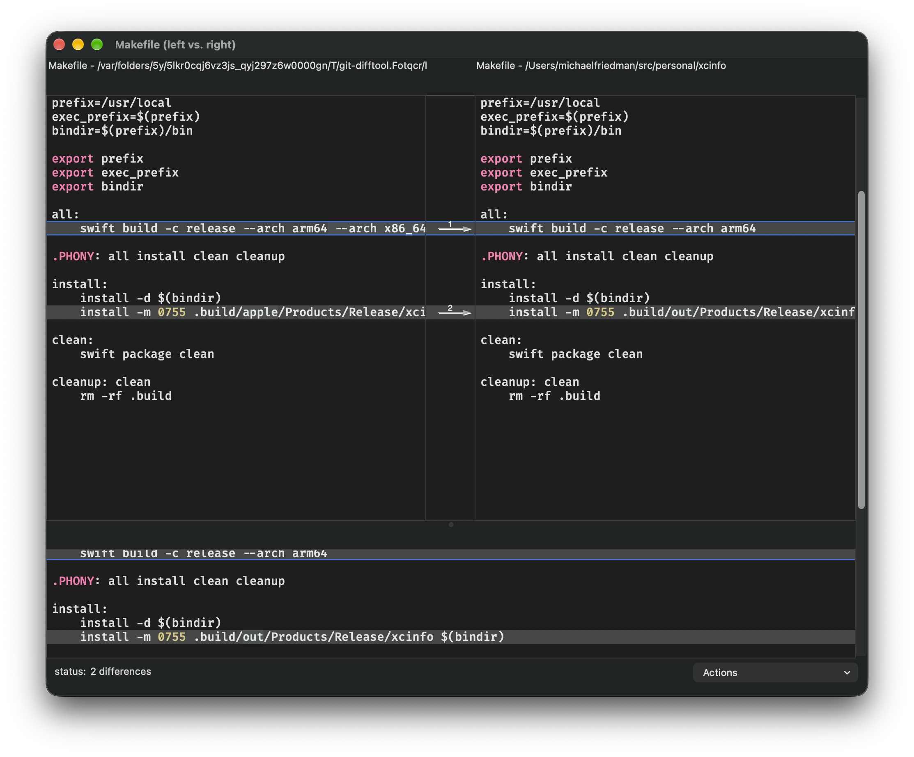
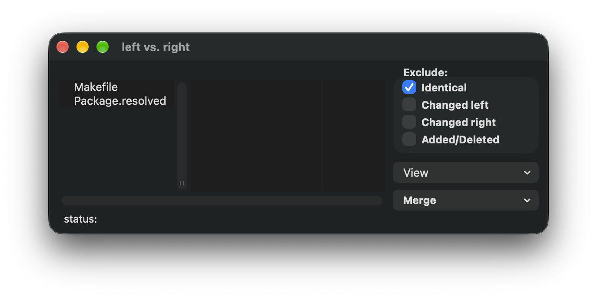
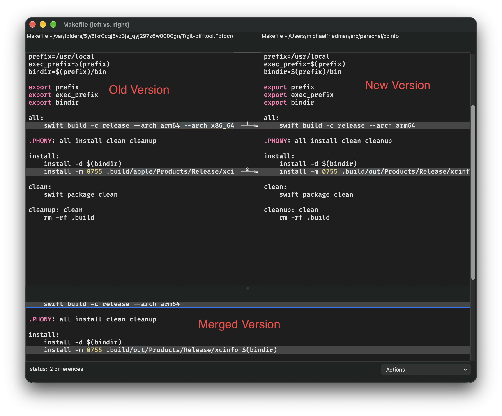

Included with Xcode since its earliest days, [FileMerge](https://en.wikipedia.org/wiki/Apple_Developer_Tools#FileMerge) might just be the most underrated tool in the package. It is a powerful, free visual code difference tool that many developers overlook.



## Getting Started

Because it comes as part of the Xcode download, you have to install Xcode to get it. And don’t let the last update date in 2018 fool you — it’s still supported and included even on Xcode 27.3.

Setting it up is straightforward. Because FileMerge relies on the opendiff command-line tool, you can easily configure Git to use it by running the following commands:

```shell
> git config set --global diff.tool opendiff
> git config set --global merge.tool opendiff
```
or edit your `~/.gitconfig` directly like so:

```yaml
[merge]
        tool = opendiff
[diff]
        tool = opendiff
```


## Using FileMerge With Git

Use `git difftool -d` to launch FileMerge with your changes. It pops up a handy completely-keyboard-navigable folder diff chooser to see which files have changed.

### Choosing a File



You can use the arrow keys to navigate through the columns and files and hit ⏎ to open the diff for any changed file. Options let you show/hide changes by file, so you can choose to ignore brand new files, for example.

| Key | Effect                                                       |
|-----------|--------------------------------------------------------------|
| 🔼        | Previous file                                     |
|    🔽     | Next file                                         |
|   ◀️       | Move up one folder |
|   ▶️       | Move down one folder |
|    ⏎      | Show the differences for the selected file |

### Viewing Differences



Once you are looking at a single changed file, it shows the old version on the left and the new version on the right. You can use the arrow keys to navigate the diff:

| Key | Effect                                                       |
|-----------|--------------------------------------------------------------|
| 🔼        | Show previous difference                                     |
|    🔽     | Show next difference                                         |
|   ◀️       | Choose version in the left pane to include in the merged file |
|   ▶️       | Choose version in the right pane to include in the merged file |

The fully-merged file is shown at the bottom of the window, where you can edit it in place, mid-diff, if you want.

> **Pro Tip:** By default, FileMerge doesn't know where to save your changes. If you want to edit files regularly inside FileMerge, it helps to follow [these instructions](https://gist.github.com/gwarnes-mdsol/b0aff96fbb7a4c92e570e7b03daa7e1b) to create a `gdiff` command which fills in the correct directories for old and new files automatically.
